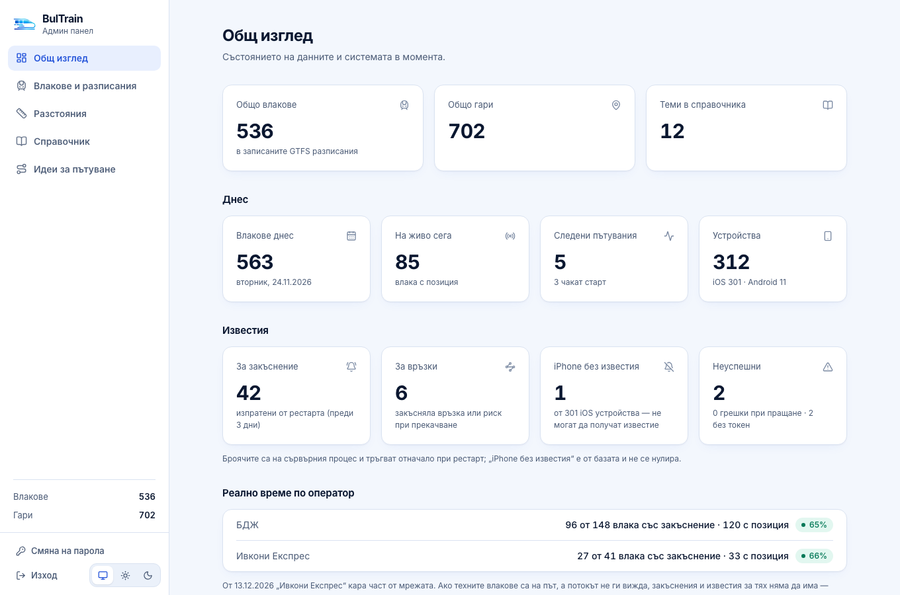
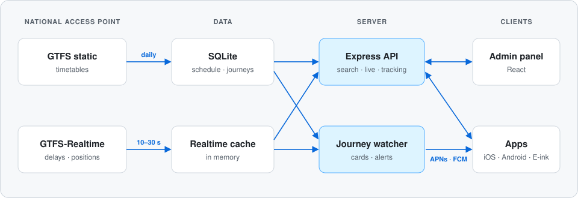

<div align="center">


# BulTrain Backend

**Live trains for Bulgaria.**
The API behind the BulTrain iOS and Android apps: timetables, live delays and positions, and journey tracking that follows you through every transfer.

[](https://github.com/tgarmenliev/bultrain-backend/actions/workflows/ci.yml)


[](LICENSE)

</div>

---

## What it does

| Capability | What you get |
|---|---|
| 🚆 **Timetables & journey search** | Built from Bulgaria's national GTFS feed, by date. Finds routes with transfers across every operator: БДЖ and, from December 2026, Ивкони Експрес. |
| 📡 **Live delays & positions** | Follows the national GTFS-Realtime feed every few seconds. Says plainly when there is no live data instead of guessing. |
| 📱 **Journey tracking** | iOS Live Activities and Android live notifications, started by the server at the right moment and carried across transfers. |
| 🔔 **Smart alerts** | A delay alert when it matters, and a separate warning when a delay puts a **connection** at risk, in Bulgarian and English. |
| 🗺️ **Live map** | Every moving train with its position, delay, type, origin, destination and operator. |
| 🛠️ **Admin panel** | React dashboard for schedule health, realtime coverage per operator, notifications, a distance calculator and an author portal for travel articles. |

<div align="center">

<br />
<sub>The admin overview, with sample data.</sub>
</div>

## How it works

<div align="center">

</div>

## Principles

- **No data, no claim.** Never says a train is on time without a measurement behind it. When the source is down the apps are told why, and nothing is invented.
- **Small on purpose.** One SQLite database, no ORM, a handful of dependencies. Auth hashing, JWTs and APNs use Node built-ins.
- **Deploy dark, switch on later.** Background jobs sit behind flags, so new code can ship and be inspected before it starts working.
- **Tested.** More than 500 tests, run on every push; the schedule import refuses a feed it cannot understand and keeps serving the previous one.

## Tech stack

| Layer | Choice |
|---|---|
| **Runtime** | Node.js 24 · Express 5 (CommonJS) |
| **Data** | SQLite via `better-sqlite3` (WAL) · in-memory cache for realtime |
| **Sources** | Bulgarian National Access Point: GTFS static and GTFS-Realtime |
| **Push** | Apple APNs (Live Activities, alerts) · Firebase Cloud Messaging |
| **Admin panel** | React · TypeScript · Vite · Tailwind |
| **Delivery** | GitHub Actions CI · pm2 behind nginx |

## Getting started

```bash
git clone https://github.com/tgarmenliev/bultrain-backend.git
cd bultrain-backend
npm install

cp .env.example .env              # fill in the keys and secrets
node scripts/seed-stations.js     # the station list
bash scripts/gtfs-refresh.sh      # download and import the timetable

npm start                     # http://localhost:3000
npm test                      # syntax, migrations, route load and the unit tests
```

Everything is configured through environment variables, and nothing secret is committed. See [`.env.example`](.env.example) for the annotated list.

## API at a glance

All `/api` routes are for the apps and need an `X-Bultrain-Api-Key`. `/health` is public.

| Group | What it gives |
|---|---|
| `/api/schedule` | Journey search between two stations on a date |
| `/api/train-info` | One train: stops, times, category and operator |
| `/api/realtime` | Live delay and position per train, and the live map |
| `/api/route-shape` | Track geometry for the per-train map |
| `/api/live-activity` | Journey tracking: device registration, arming, Live Activity tokens |
| `/api/stations` · `/api/network` | Station list and a public snapshot of the running network |
| `/api/guide` · `/api/articles` | Travel guide and author-written articles |
| `/api/admin` | Admin panel (cookie session, roles) |

## Project structure

```
server.js            entry point
routes/ controllers/ the HTTP layer
services/
  gtfs/              timetable import, categories, operators, route shapes
  realtime/          GTFS-Realtime poller, cache, per-train status
  liveactivity/      journey tracking, alerts, APNs / FCM delivery
  network/ auth/     the living-network snapshot, admin sessions
workers/             route search (runs in a worker thread)
database/            migrations
admin-ui/            React admin panel
scripts/             refresh, backups, diagnostics, CI check
test/                unit and integration tests
docs/                the technical handbook
```

## Documentation

The full reference lives in the **[technical handbook](docs/HANDBOOK.md)**: the data pipeline, realtime, Live Activities and notifications, the admin panel, configuration, deployment and operations.

## License

[ISC](LICENSE) © 2026 Tihomir Garmenliev

---

<div align="center">
<sub>Built for Bulgarian rail passengers. Timetable and realtime data come from the Bulgarian National Access Point.</sub>
</div>
